# CFD-MD-plotting

[English](README.md) | **简体中文**

面向 CFD 与分子动力学结果的出版级绘图。由两个相互配合的 agent skill 组成，共用同一套配色、字体与排版系统。

| Skill | 用途 |
|---|---|
| [`sim-plot`](skills/sim-plot) | 折线、散点、柱状、工况对比、小多图、残差与受力监控、parity 图。内含共享层 `scivis`。 |
| [`sim-field`](skills/sim-field) | 物理场：云图、等值线、流线、切片、网格场、MD 密度与电荷分布图。从 `sim-plot` 引用 `scivis`。 |

两个 skill 都有两种模式：

- **新建**：从已处理好的数据出图，**按你指定的布局与要求**（面板网格、毫米尺寸、配色含义、坐标范围、标签）：`render_plot.py`、`render_field.py`、recipes 或自定义布局模板。见[新建图（create 模式）](#新建图create-模式)。
- **美化已有图**（"帮我优化这张图"）：数据层被冻结并接受审计，只改变呈现层。见[美化已有图（restyle 模式）](#美化已有图restyle-模式)与[使用流程](#使用流程)。

## 主要能力

- **以毫米为单位排版。** 图按最终尺寸建立（论文、幻灯片、海报档位的宽度为 89 / 120 / 183 mm）。场图按物理纵横比绘制；细长面板会变成窄图，而不是被拉伸。
- **字体。** 默认 Arial，按介质（论文 / 幻灯片 / 海报）使用固定的字号层级，支持数学公式与可选的中文标签。仅在明确授权时才回退字体，并写入记录。
- **按物理含义选色。** 序列与发散数据使用 Crameri 色图（batlow、带白色中心的 vik、lajolla、oslo、bilbao、romaO），分类数据使用 Paul Tol 色组；带 CAM02-UCS 审计，并对常数或含 NaN 的色标范围做保护。
- **全框坐标轴、带框图例、位于面板外侧的色标**；过长的色标标签自动改为侧向放置。
- **Recipes：** CFD 监控曲线、MD 折线面板、带边缘分布的 parity 图、ghost 小多图、幻灯片改编、带流线的场图面板、尾流放大插图。
- **导出前 QA 关卡。** 文字被裁切、字号过小、色标缺少标签、字体被替代、数学公式内含中文、画布宽度不符，都会阻止导出。每张图同时生成 `.viz.json` 溯源文件和图注草稿。
- **OpenFOAM 辅助：** 健壮的 `postProcessing` `.dat` 读取器和日志残差读取器。

## 安装

把两个文件夹并列放入 agent 的 skills 目录，保持同级：

```
<skills 目录>/
├── sim-plot/
└── sim-field/
```

`python install.py --target codex|claude|omp --scope user` 可代为复制（默认只做演练，加 `--apply` 才会真正复制）。
然后执行 `pip install -r requirements.txt`（numpy、matplotlib、cmcrameri；tol-colors 与 colorspacious 为可选）。
本仓库不附带 Arial，请自行安装；也可以加 `--allow-font-fallback` 输出草稿图。
无需修改 `AGENTS.md`：每个 `SKILL.md` 自带调用规则（何时使用、何时不用、选用哪种模式）。

## 快速开始

```bash
python skills/sim-plot/scripts/render_plot.py examples/line.json --out out/line
python skills/sim-field/scripts/render_field.py examples/field_wake.json --overwrite
python -m pytest tests -q          # 61 个测试
python verify.py                   # 端到端检查（运行时请勿设置 SCIVIS_ALLOW_FONT_FALLBACK）
```

所有示例与 recipe 的预览图在 [`previews/`](previews) 中。示例数据均为合成数据。

## 新建图（create 模式）

适用于有自己的布局和要求的新图（"三个面板，183 mm 宽，面板字母 a–c，y 范围一致，工况 A 始终用蓝色"）：

1. agent 先读取你已经说明的内容（布局、尺寸、配色含义、坐标范围、输出）以及数据。
2. 它一次最多提 4 个带推荐答案的问题，只问缺少的信息：`create_layout`、`create_size`、`create_encoding`、`create_requirements`。无人值守时使用推荐答案，并如实记录"无人确认"。
3. 它在共享画布上构建图：单个已处理好的面板用 `render_plot.py` / `render_field.py`；接近的情形用 recipe；其他布局用 [`custom_layout_template.py`](skills/sim-plot/recipes/custom_layout_template.py)（行×列、宽高比例、跨格面板、面板字母、位于外侧的色标）。
4. QA 关卡通过后输出 pdf / png（600 dpi）/ svg，以及记录你的需求与布局的 `.viz.json` 和图注草稿。

完整流程及"需求 → API"对照表见 [`skills/sim-plot/references/create-mode.md`](skills/sim-plot/references/create-mode.md)。

## 美化已有图（restyle 模式）

适用于已有图以及生成它的代码：

1. agent 先找到原绘图代码，并运行模板一次。它会读出并打印原图的实际设置：色图、色标范围、extend 箭头、超出范围的单元比例、平滑与插值、图的尺寸。
2. 它引用这些事实，一次最多提 4 个带推荐答案的问题（`restyle_scope`、`restyle_size`、`restyle_frames`，以及原脚本不明确时的确认）。脚本中的关卡（`CONTRACT["confirmed"]`）会阻止未确认就出图；无人值守时使用 `--assume-defaults`，并被如实记录。
3. 它用 `scivis` 重建面板。数值、平滑、插值、色标范围、extend、坐标范围、单位与文字被**冻结**；字体、尺寸、边框、刻度、色标和描边被替换。冻结层与原图不一致时拒绝导出。更换色图需要明确同意（带符号的场使用 vik）。
4. 输出：图（pdf / png / svg）、带审计结果的 `.viz.json`、图注草稿，以及前后对比图。

模板位于 [`skills/sim-field/templates/`](skills/sim-field/templates)，完整流程见
[`skills/sim-plot/references/restyle-mode.md`](skills/sim-plot/references/restyle-mode.md)。

## 使用流程

下面的代码块中，`You` 是你输入的内容，卡片是 agent 提出的问题（在支持的 agent 客户端中显示为选择题卡片，否则以纯文本提问并等待回答）。卡片的具体外观取决于你的 agent 客户端；问题 id、选项与默认值由 skill 规定。

### 流程 1：美化已有图（restyle）

```text
You   > 用 /sim-field 帮我优化这张电场图。

Agent > 找到绘图代码 results/figures/plot_rz_charge.py，已在禁止保存的情况下运行一次。
        原图使用：RdBu_r，色标范围 ±2.8（97.5 百分位，2% 的单元被截断，两端 extend），
        高斯平滑 sigma 0.8 + 双线性插值 ×4，r/z 单位 Å，600×1100 px。除非你另有说明，这些保持冻结。

─── [restyle_scope] 这一轮采用哪种优化范围？
    ◉ 白心 vik＋版式优化（推荐）
    ○ 仅优化版式（保留 RdBu_r）
    ○ 同时调整显示参数
─── [restyle_size] 图幅采用哪一种？三种均输出 PDF、600 dpi PNG 和 SVG。
    ◉ 紧凑论文图（推荐）
    ○ 严格 89 mm 宽
    ○ 汇报展示图
─── [restyle_frames] 这次处理一张代表图，还是全部现有图？输出均写入新的独立目录。
    ◉ 同一张代表图（推荐）
    ○ 全部 30 张

You   > （接受全部推荐答案）

Agent > 开始渲染。冻结层审计：一致（数值、平滑、色标范围、extend、坐标轴、单位、文字）。
        按你的要求改动：RdBu_r -> vik（白色中心）。原文件未被写入。
        restyle_out/rz_charge_restyled.pdf | .png（600 dpi）| .svg
        restyle_out/rz_charge_restyled.viz.json        （审计结果与上述回答）
        restyle_out/rz_charge_restyled.caption.txt     （注明百分位色标范围与平滑）
        restyle_out/rz_charge_restyled.before_after.png
```

各选项在 harvest 模板（[`restyle_harvest_template.py`](skills/sim-field/templates/restyle_harvest_template.py)）中的对应设置：

| 问题 | 选项 | 模板设置 |
|---|---|---|
| `restyle_scope` | vik＋版式 / 仅版式 / 调整显示参数 | `OPT_IN["cmap"]` = `"signed-if-diverging"` / `None` / 另加 `OPT_IN["vlim"]` 等 |
| `restyle_size` | 紧凑 / 严格 89 mm / 汇报 | `SIZE_MODE` = `"compact"`（面板高度 ≤ 80 mm，细长面板变成窄图）/ `"strict-89"` / `"presentation"`（宽 160 mm，面板高度 ≤ 110 mm）；`DPI = 600` |
| `restyle_frames` | 一张 / 全部 | `FRAMES` 只含一项，或为每个现有帧各一项；文件写入 `OUT_DIR` |

无人值守时不会出现卡片：`--assume-defaults` 使用推荐答案，并记录"无人确认"。

### 流程 2：按你的布局与要求新建图

```text
You   > 用 /sim-plot 为论文做一张 3 面板图：(a) 工况 1–3 的速度剖面，(b) Cp 预测值与参考值的 parity 图，
        (c) 三种几何的压降柱状图。等高，183 mm 宽，带面板字母。工况沿用上一张图的颜色。

Agent > 已读取 results/profiles.csv、cp_parity.csv、dp.csv（单位：m/s、-、kPa）。要点：模型复现了 Cp，几何 C 的压降最低。
        介质：论文。配色：工况为分类，柱状图的颜色不携带含义。

─── [create_layout] 面板如何排布？
    ◉ 1×3 一行，面板等大，字母 a–c（推荐）
    ○ 2×2 网格，留一个空格
    ○ 自定义：我来描述
─── [create_size] 图幅采用哪一种？均输出 PDF、600 dpi PNG 和 SVG。
    ◉ 论文双栏 183 mm × 52 mm（推荐）
    ○ 论文单栏 89 mm
    ○ 幻灯片
─── [create_encoding] 颜色表示什么？
    ◉ 工况为分类，沿用上一张图的颜色（推荐）
    ○ 工况为有序参数（序列色图）
    ○ 颜色不携带含义（灰色＋一个强调色）
─── [create_requirements] 有哪些必须满足的硬性要求？
    ◉ 除布局外没有（推荐）
    ○ 我来列出（坐标范围、共享范围、标签）

You   > （接受全部推荐答案）

Agent > 已把 recipes/custom_layout_template.py 复制到 results/figures/make_fig3.py，填写了 BRIEF、WIDTH、PANELS 和三个数据函数，并运行。
        QA：通过（裁切、字号、画布宽度 183.0 mm）。已对照图检查各项要求：
        三个面板、等高、字母 a–c、工况颜色与之前一致。
        figures_out/fig3.pdf | .png（600 dpi）| .svg
        figures_out/fig3.viz.json       （需求、布局与回答）
        figures_out/fig3.caption.txt
```

agent 的具体措辞会有所不同。skill 强制执行的是这个顺序：读取需求、只问缺少的信息、说明要点与配色含义、通过共享画布渲染、QA 关卡、把需求记录进溯源文件。上面的三面板示例，就是模板在其合成占位数据下生成的效果（见图库）。

## 图库

所有图片位于 [`previews/`](previews)，由 [`examples/`](examples) 中的脚本基于合成数据生成。

**带流线的场图面板**（`cfd_field_panels`）：速度、压力系数与涡量位于同一画布。带符号的场使用带白色中心的 vik。

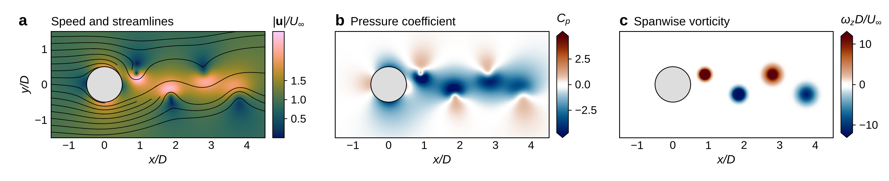

**restyle 前后对比**（`restyle_demo`）：左为原图，右为美化后。数据、平滑、色标范围与单位完全一致；改变的是色图（vik）、字体、边框与色标。

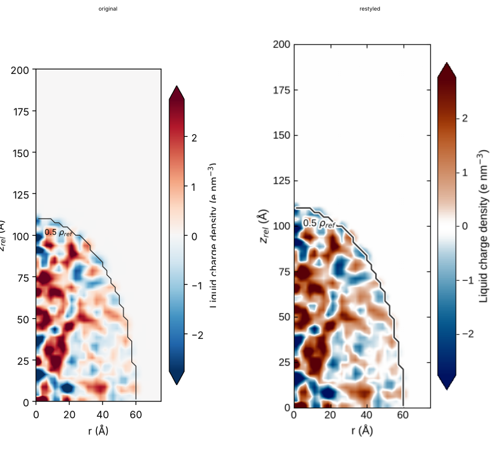

| | |
|---|---|
| 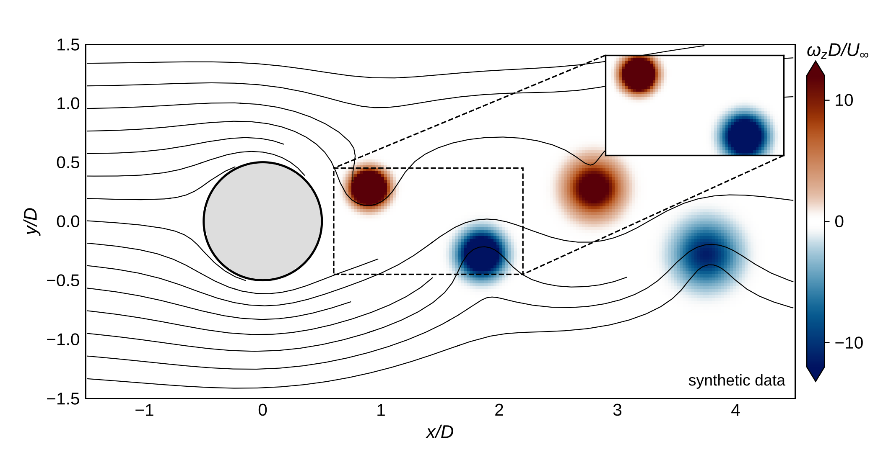<br>**尾流场**（`field_wake`） | 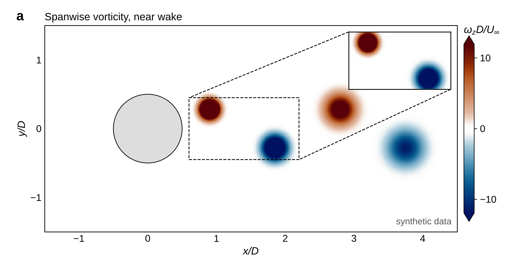<br>**放大插图**（`wake_zoom`） |
| 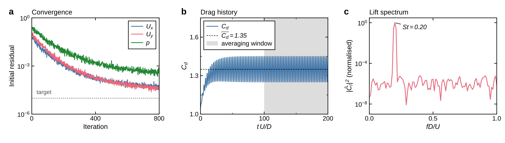<br>**残差与受力监控**（`cfd_monitors`） | 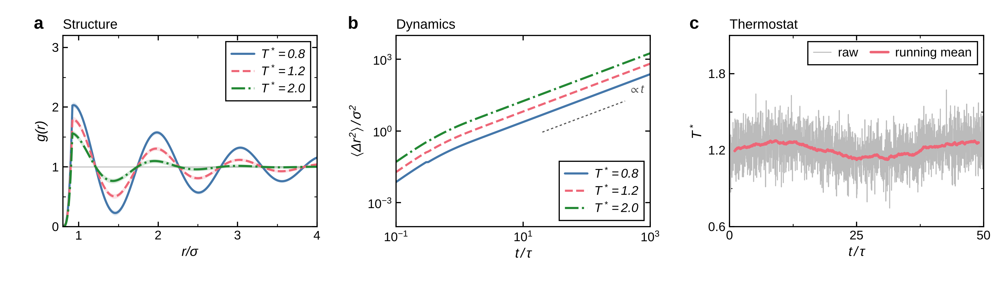<br>**MD 折线面板**（`md_line_panels`） |
| 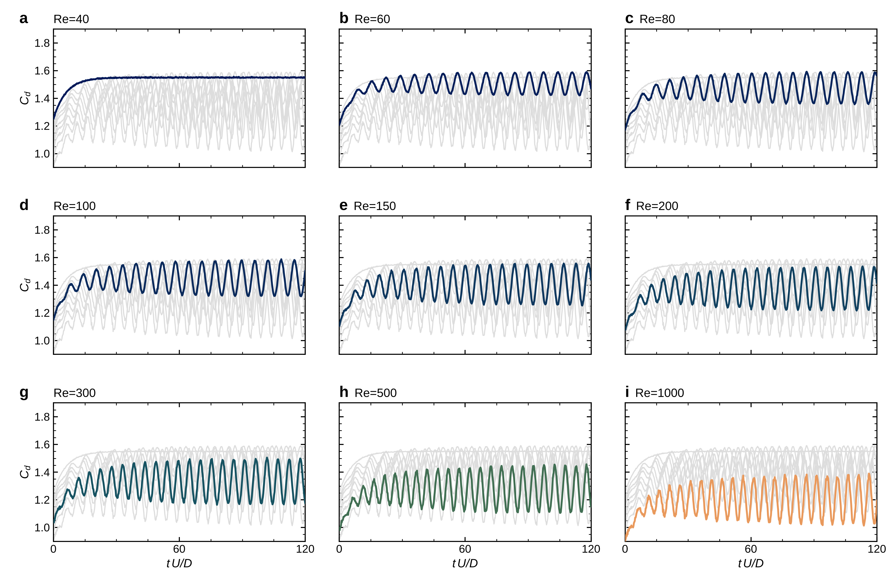<br>**Ghost 小多图**（`ghost_multiples`） | 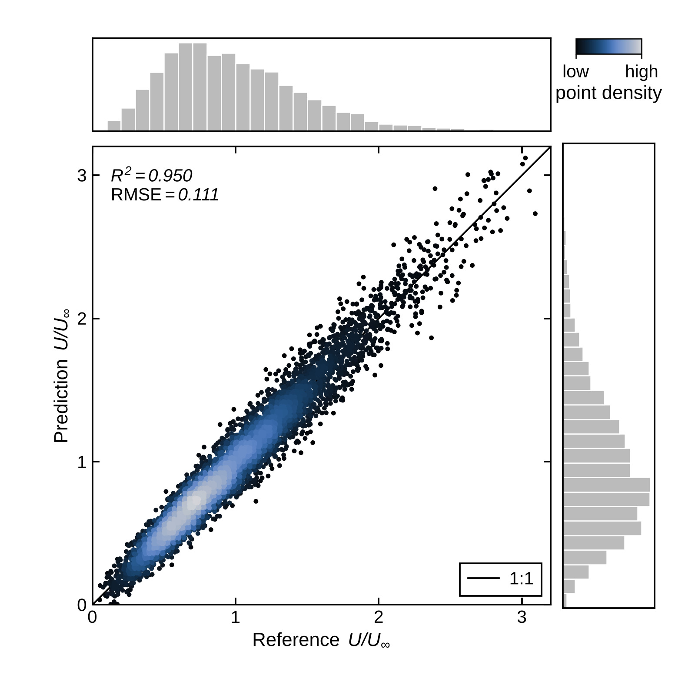<br>**带边缘分布的 parity 图**（`scatter_parity`） |
| 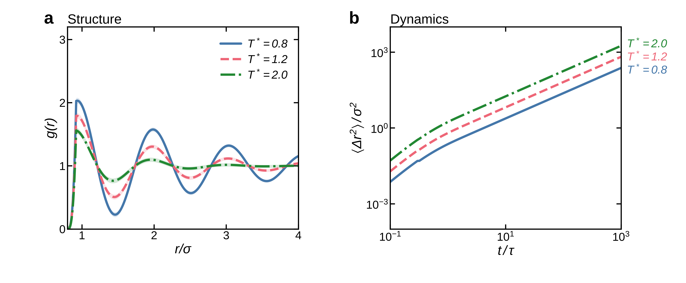<br>**论文图改编为幻灯片**（`slide_adaptation`） | 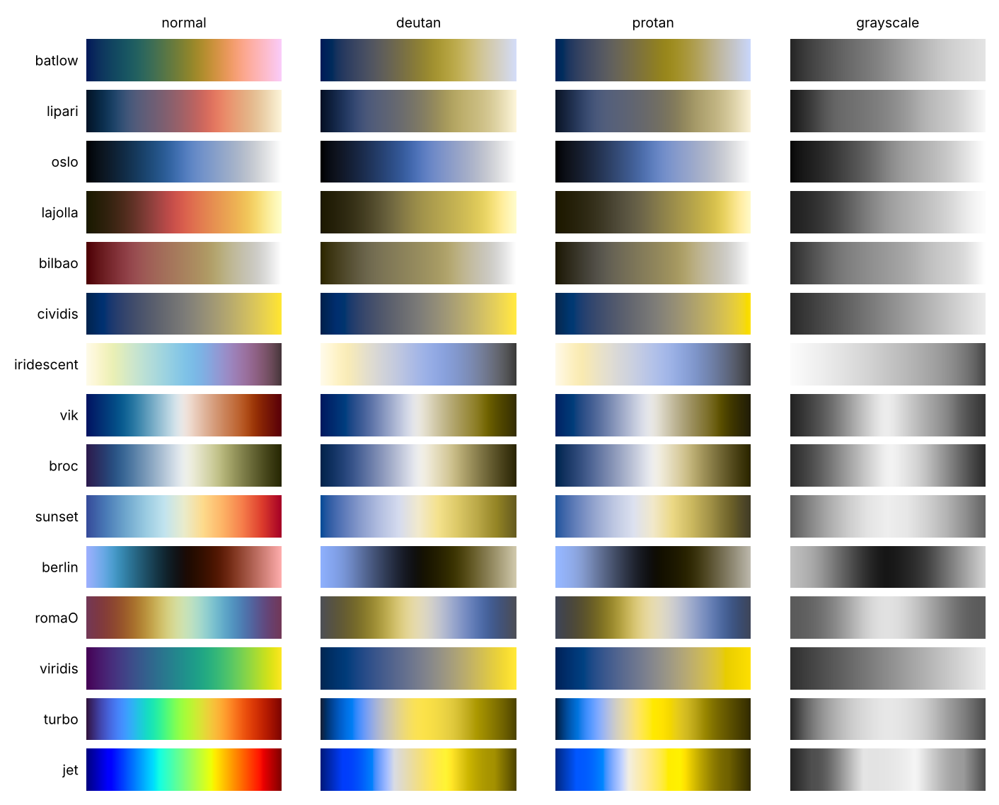<br>**色彩审计**（`color_audit`） |
| 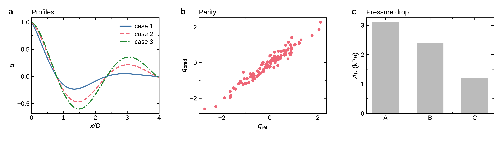<br>**由模板生成的自定义 1×3 布局**（`custom_layout`） | |

## 仓库结构

```
skills/sim-plot/    SKILL.md（含调用规则）、scripts/scivis（共享层）、scripts/render_plot.py、recipes/（含 custom_layout_template.py）、references/（含 create-mode、restyle-mode 等）、assets/
skills/sim-field/   SKILL.md、scripts/render_field.py、recipes/、templates/、references/
examples/           合成数据的配置与数据，以及一个示例"原始"绘图脚本
previews/           示例渲染结果
tests/              pytest 测试
docs/               DESIGN.md（设计决策）、UPGRADING.md（升级说明）
```

## 状态与限制

- 已在合成数据和一份真实场数据导出上开发与测试；OpenFOAM、ParaView 以及 restyle 路径尚未在大量真实项目中验证。如遇问题，欢迎提交 issue。
- 本仓库预览图使用与 Arial 度量兼容的替代字体渲染。
- 未包含：沿曲线的等值线标注、书中的 `Streamlines` 类（提供了 `streamplot` 封装）、期刊专项合规检查。
- 数据本身的科学有效性不在范围内；`.viz.json` 记录的是"画了什么"，而不是"对不对"。

## 致谢与许可

设计思路参考 N. P. Rougier 的 *Scientific Visualization: Python + Matplotlib*，详见 [`SOURCES.md`](SOURCES.md)。
本仓库以 [MIT 许可证](LICENSE)发布。随附的第三方资源保留各自的许可证（cmcrameri 色表：MIT；Roboto 字体：Apache-2.0）。
